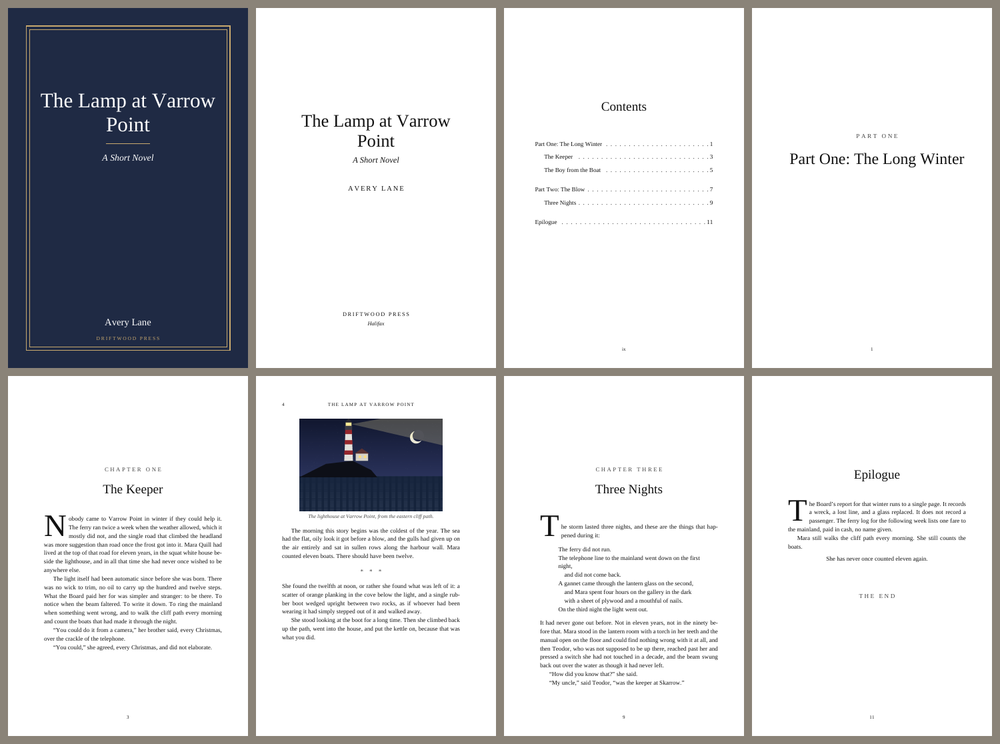

# BookPress

Turn plain text and pictures into a PDF that looks like a **real printed book**.

You write (or paste) your text in a simple format, add images, press *Build*,
and get a PDF with everything a proper book has:

- a cover (five designs, or your own picture)
- half-title, title page, copyright page, dedication and epigraph pages
- a table of contents with page numbers (and clickable PDF bookmarks)
- part dividers and chapter openers that always start on a right-hand page,
  with "Chapter One / Two / Three" labels and a drop cap on the first paragraph
- justified, hyphenated body text in a real serif font with no widows or orphans
- running heads (book title on the left page, chapter title on the right),
  page numbers (roman numerals in the front matter), mirrored inside/outside
  margins for binding
- pictures with captions, full-page plates, scene breaks, block quotes, verse,
  centered lines, "The End"
- lists, tables, framed boxes, footnotes, chapter epigraphs, pictures with
  text flowing around them, side-by-side pictures, full-page plates
- presets (classic novel, modern, manuscript, poetry, non-fiction, large
  print, children) and about ninety individual settings, all in a visual
  settings panel
- 35 languages with the right quotation marks, hyphenation and labels,
  including Japanese, Chinese and Korean
- outputs for the screen, a home printer (fold-and-staple booklet) and
  print-on-demand (interior + wrap-around cover with spine)



## Download (no install)

Go to the **[Releases page](https://github.com/henss2007-dot/making-stuff-for-fun/releases)**
and pick the file for your computer:

| Computer | File | How to start |
|---|---|---|
| Windows | `BookPress-windows.exe` | Double-click. If Windows says it "protected your PC", click **More info → Run anyway** (the app is free software and not signed with a paid certificate). |
| Mac with Apple chip (M1–M4) | `BookPress-macos-apple-silicon.zip` | Unzip, then **right-click → Open** the `BookPress` file the first time. |
| Mac with Intel chip | `BookPress-macos-intel.zip` | Same as above. |
| Linux | `BookPress-linux.tar.gz` | `tar xzf BookPress-linux.tar.gz && ./BookPress` |

A small terminal window opens (keep it open while you write), then your
browser opens the editor. Your books live in **Documents/BookPress**, one
folder per book: a plain text file, your pictures, and the finished PDFs.
Use the book menu in the editor's top bar to switch books or start a new one.

## Install with Python instead

```
pip install reportlab Pillow pyphen pypdf
```

(`pyphen` and `pypdf` are optional: hyphenation and the booklet output.)
Python 3.9 or newer. Or install BookPress itself from this folder, which
gives you a `bookpress` command:

```
pip install .
```

## Use it

The editor runs in your browser:

```
python -m bookpress serve mybook
```

This creates a folder `mybook` with a sample `book.md` (a short story that
shows every feature) and an `images` folder, then opens the editor. Point it
at a folder that holds several book folders and it becomes a library with a
book switcher (`python -m bookpress serve ~/Documents/BookPress`).

- **left**: your book as text, with buttons for chapters, images, scene breaks...
- **right**: the PDF, refreshed every time you press **Build PDF** (or Ctrl+Enter)
- **+ Image…** (or drag a picture onto the text, or paste one) copies the file
  into `images/` and inserts it at the cursor
- **Download** saves the finished PDF

Your book is saved as `mybook/book.md`, a plain text file, and the PDF as
`mybook/book.pdf`. Nothing leaves your computer.

Without the editor:

```
python -m bookpress new mybook          # make the folder + sample
python -m bookpress build mybook        # writes mybook/book.pdf
python -m bookpress build mybook/book.md -o ~/Desktop/my-book.pdf
```

## The format

The top of the file is the settings block, then the book:

```
---
title: The Lamp at Varrow Point
subtitle: A Short Novel
author: Avery Lane
year: 2026
publisher: Driftwood Press
language: en
theme: classic
output: book
---

@part Part One: The Long Winter

# The Keeper
@subtitle In which nobody comes
@epigraph The sea does not reward the impatient. -- Anne Morrow Lindbergh

Nobody came to Varrow Point in winter if they could help it. The ferry ran
twice a week when the weather allowed, which it mostly did not...

"You could do it from a camera," her brother said.[^She never explained why not.]

{width=80%}

* * *

## What the Boy Said

> There is a kind of silence that comes after bad news.

| The ferry did not run.
| The telephone line went down on the first night,
|     and did not come back.

- Hard tack and salt pork
- Fresh water in oak casks

| Year | Keeper   | Wrecks |
|:-----|:---------|-------:|
| 1911 | T. Marrow|      3 |

::: box A note on the tides
The spring tides run two metres higher than the neaps.
:::

#* Epilogue

-> She has never once counted eleven again.
```

| You write | You get |
|---|---|
| `# Title` | A numbered chapter ("Chapter One"...). `# Chapter 3: Title` works too. |
| `#* Title` | An unnumbered chapter (prologue, epilogue, about the author) |
| `@part Title` | A part-divider page |
| `@subtitle ...`, `@epigraph Quote -- Who` | A subtitle or epigraph under the chapter title |
| `## Heading`, `### Smaller` | Headings inside a chapter |
| `@pagebreak`, `@blank` | New page; new right-hand page |
| blank line | New paragraph. Quotes and dashes become the right marks for the language: "..." → “...”, „...“, «...», 「...」 |
| `*italic*` `**bold**` `***both***` | Emphasis. Also `__underline__`, `~~strike~~`, `^^small caps^^`, `x^2^`, `H,,2,,O`, `` `typewriter` ``, `{red}colour{/}` |
| `text[^A note]` | A footnote, printed at the end of the chapter or in a Notes chapter |
| `* * *` | Scene break |
| `> text` | Quoted paragraph |
| `\| line` | Verse: every line kept, leading spaces kept |
| `-> text` | Centered line |
| `- item`, `1. item` | Bullet and numbered lists |
| `\| a \| b \|` + `\|---\|---\|` | A table (first row is the header, `---:` right-aligns) |
| `::: box Title` ... `:::` | A framed box. Also `::: note` (shaded), `::: letter` (italic, indented), `::: right`, `::: center` |
| two spaces at line end | Line break inside a paragraph |
| `` | Picture with caption, full text width |
| `...{width=50%}` / `{width=3in}` / `{height=2in}` | Smaller picture |
| `...{wrap=right}` | Small picture with the next paragraph flowing around it |
| ` ` | Pictures side by side |
| `...{page}` | Picture on a page of its own |
| `...{border}` `{align=left}` `{nocaption}` | Border, alignment, no caption |
| `// note` | A note to yourself, not printed |

### Settings

Press **Settings** in the editor to see them all with explanations, grouped
as Book, Page, Typography, Chapters, Running heads, Pictures, Contents, Cover,
Front & back matter and Printing. The main ones:

| Key | What it does |
|---|---|
| `theme` | A preset look: `classic` (novel), `modern` (sans headings, block paragraphs), `manuscript` (typewriter, double spaced, for submissions), `poetry`, `nonfiction` (numbered figures, notes at the back, deeper contents), `large_print`, `children`. Anything you set yourself overrides the preset. |
| `language` | 35 languages: `en`, `en_GB`, `de`, `de_CH`, `fr`, `es`, `it`, `pt`, `pt_BR`, `nl`, `sv`, `da`, `nb`, `fi`, `pl`, `cs`, `sk`, `hu`, `ro`, `tr`, `ru`, `uk`, `el`, `ca`, `hr`, `sl`, `bg`, `lt`, `et`, `is`, `id`, `ja`, `zh`, `zh_TW`, `ko`. Sets hyphenation, quotation marks, the words "Chapter", "Contents", "Figure", "The End", the copyright page wording, and the fallback font. Other codes work too (hyphenation only). |
| `output` | `book`: complete PDF with cover and blank left-hand pages. `screen`: no blank pages, for phones and tablets. `booklet`: also writes `book-booklet.pdf`, two pages per sheet, ordered for folding and stapling (needs `pypdf`). `print`: an interior without the cover plus `book-cover.pdf`, a wrap-around cover with spine and barcode box for Lulu, KDP, Blurb and the like. |
| `trim`, `margins`, `margin_*`, `paper` | Page size (`5x8`, `5.5x8.5`, `6x9`, `7x10`, `a5`, `b5`, `a4`, `letter`, `pocket`, `14x21cm`...), margin preset or exact margins, paper colour |
| `font`, `heading_font`, `cover_font` | Any font on your computer, or `serif`, `sans`, `typewriter`, or a .ttf path. `bookpress fonts` lists what it finds and offers free downloads (EB Garamond, Crimson Pro, Lora, Merriweather, Noto Serif JP/SC/TC/KR...). |
| `font_size`, `line_spacing`, `align`, `paragraph_style`, `paragraph_indent`, `paragraph_space`, `hyphenate`, `widows_orphans`, `ink`, `accent` | Typography |
| `chapter_style` | `classic`, `number` (big numeral), `simple`, `modern`, `minimal`, `ornate` |
| `chapter_label`, `chapter_number_style`, `chapter_align`, `chapter_title_size`, `chapter_drop`, `drop_caps`, `drop_cap_lines`, `opener_caps` | Chapter openers |
| `heading_style`, `heading_align`, `scene_break`, `scene_break_image`, `quote_style`, `notes` | Inside chapters |
| `running_heads`, `verso_head`, `recto_head`, `page_numbers`, `head_rule` | What goes at the top of each page and where the page number sits |
| `figure_numbers`, `figure_label`, `image_border`, `image_max_height`, `caption_style` | Pictures |
| `toc`, `toc_title`, `toc_depth`, `toc_style` | Contents |
| `cover`, `cover_style` (`classic`, `bold`, `minimal`, `photo`, `plain`), `cover_image`, `cover_image_fit`, `cover_color`, `cover_accent`, `cover_text_color`, `cover_title_size` | Cover |
| `half_title`, `title_page`, `copyright_page`, `also_by`, `dedication`, `epigraph`, `epigraph_source`, `year`, `publisher`, `publisher_city`, `isbn`, `edition`, `fiction`, `rights`, `website`, `the_end` | Front and back matter |
| `booklet_sheet`, `bleed`, `paper_stock`, `spine_text`, `blurb`, `back_image`, `barcode_box`, `crop_marks` | Printing |

## Languages

Set `language:` and the book switches wholesale: German gets „Anführungszeichen“,
"Kapitel", "Inhalt" and "Alle Rechte vorbehalten"; French gets « guillemets »
with the proper thin spaces; Japanese gets 「かぎ括弧」, 第一章 chapter labels,
目次, a Japanese font and line breaking that works without spaces. The fixed
words can always be overridden (`chapter_label`, `toc_title`, `figure_label`,
`the_end_text`, `notes_title`).

For Japanese, Chinese and Korean a font from your computer is used if there
is one (Yu Mincho, MS Mincho, Hiragino, SimSun, Batang...); otherwise download
one: `bookpress fonts get noto-serif-jp` (or `noto-serif-sc`, `noto-serif-tc`,
`noto-serif-kr`). Vertical Japanese text and right-to-left scripts (Arabic,
Hebrew) are not supported yet.

## Printing and sharing

- **Reading on a screen:** `output: screen`.
- **Home printer:** `output: booklet` and print `book-booklet.pdf` double-sided
  (flip on the short edge), then fold the stack in half and staple.
- **Print-on-demand:** `output: print`. Upload `book.pdf` as the interior and
  `book-cover.pdf` as the cover. The spine width follows the page count and
  `paper_stock`; `bleed` defaults to the usual 0.125 in. Check the service's
  template for its exact numbers.
- **A gift:** the default `output: book` with a cover and blank pages reads
  like a bound book in any PDF viewer (turn on two-page view).

## How it works

`bookpress/parse.py` turns the text into chapters and blocks;
`bookpress/build.py` lays them out with [ReportLab](https://www.reportlab.com/)
(page templates for cover / front matter / body, a multi-pass build so the
table of contents gets real page numbers, custom flowables for drop caps and
letter-spaced small-caps lines); `bookpress/server.py` is a small local web
server for the editor in `bookpress/ui.html`.

`bookpress/i18n.py` holds the per-language words and quotation marks,
`bookpress/options.py` every setting with its default and help text (the
settings panel is generated from it), `bookpress/cover.py` the wrap-around
cover and `bookpress/booklet.py` the booklet imposition.

Tests: `python -m pytest tests` (needs `pytest` and `pypdf`). The downloadable
apps are built by `.github/workflows/release.yml` with PyInstaller from
`bookpress.spec` whenever a `v*` tag is pushed; `pyinstaller bookpress.spec`
builds one locally.
