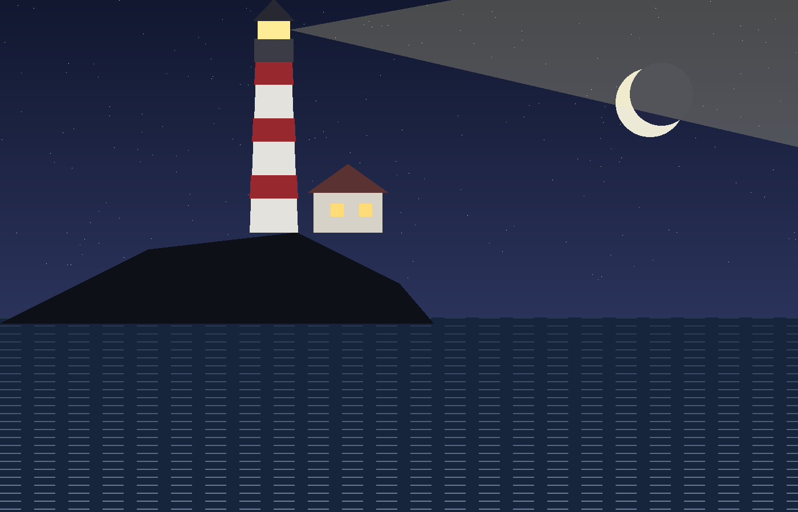

@part Part One: The Long Winter

# The Keeper

Nobody came to Varrow Point in winter if they could help it. The ferry ran twice a week when the weather allowed, which it mostly did not, and the single road that climbed the headland was more suggestion than road once the frost got into it. Mara Quill had lived at the top of that road for eleven years, in the squat white house beside the lighthouse, and in all that time she had never once wished to be anywhere else.

The light itself had been automatic since before she was born. There was no wick to trim, no oil to carry up the hundred and twelve steps. What the Board paid her for was simpler and stranger: to be there. To notice when the beam faltered. To write it down. To ring the mainland when something went wrong, and to walk the cliff path every morning and count the boats that had made it through the night.

"You could do it from a camera," her brother said, every Christmas, over the crackle of the telephone.

"You could," she agreed, every Christmas, and did not elaborate.

{width=80%}

The morning this story begins was the coldest of the year. The sea had the flat, oily look it got before a blow, and the gulls had given up on the air entirely and sat in sullen rows along the harbour wall. Mara counted eleven boats. There should have been twelve.

* * *

She found the twelfth at noon, or rather she found what was left of it: a scatter of orange planking in the cove below the light, and a single rubber boot wedged upright between two rocks, as if whoever had been wearing it had simply stepped out of it and walked away.

She stood looking at the boot for a long time. Then she climbed back up the path, went into the house, and put the kettle on, because that was what you did.

# The Boy from the Boat

He was sitting on her doorstep when she came back from the cove with the boot in her hand. He could not have been more than fourteen. His hair was stiff with salt and he was wearing one sock.

"That's mine," he said, pointing at the boot. His teeth were chattering so badly the words came out in pieces.

Mara looked at him. She looked at the boot. Then she opened the door and stood aside, and he went in ahead of her like a dog that has been told, once, that it is allowed on the furniture.

## What the Boy Said

His name was Teodor, he said, once he had stopped shaking, and he had been on the *Kestrel* with his uncle, and his uncle was not on the doorstep and had not been on the beach, and when Mara asked him gently whether his uncle could swim he looked at her with such flat, adult patience that she did not ask again.

> There is a kind of silence that comes after bad news, and a kind that comes before it. The second is worse. You know it when you hear it. It is the silence of a room where someone is deciding how much to tell you.

That was the silence in Mara's kitchen for the next quarter of an hour.

"The Board will want to know," she said finally. "About the boat."

"Don't," said Teodor.

"I have to. It's what I'm for."

He said nothing. He drank the tea. And when the wind came up at four o'clock, exactly as the sea had promised, he went to the window and watched the beam go round and round, and did not look away from it once until it was fully dark.

@part Part Two: The Blow

# Three Nights

The storm lasted three nights, and these are the things that happened during it:

| The ferry did not run.
| The telephone line to the mainland went down on the first night,
|     and did not come back.
| A gannet came through the lantern glass on the second,
|     and Mara spent four hours on the gallery in the dark
|     with a sheet of plywood and a mouthful of nails.
| On the third night the light went out.

It had never gone out before. Not in eleven years, not in the ninety before that. Mara stood in the lantern room with a torch in her teeth and the manual open on the floor and could find nothing wrong with it at all, and then Teodor, who was not supposed to be up there, reached past her and pressed a switch she had not touched in a decade, and the beam swung back out over the water as though it had never left.

"How did you know that?" she said.

"My uncle," said Teodor, "was the keeper at Skarrow."

Skarrow had been automated in 1989. Skarrow's last keeper had refused to leave, and had drowned, the story went, trying to row across to the mainland in weather no one should have rowed in. Mara had read about it when she took the job. She had been nine years old when it happened.

She looked at the boy for a long moment, and then she looked at the switch, and then she decided, as she had decided about the camera, not to elaborate.

#* Epilogue

The Board's report for that winter runs to a single page. It records a wreck, a lost line, and a glass replaced. It does not record a passenger. The ferry log for the following week lists one fare to the mainland, paid in cash, no name given.

Mara still walks the cliff path every morning. She still counts the boats.

-> She has never once counted eleven again.
